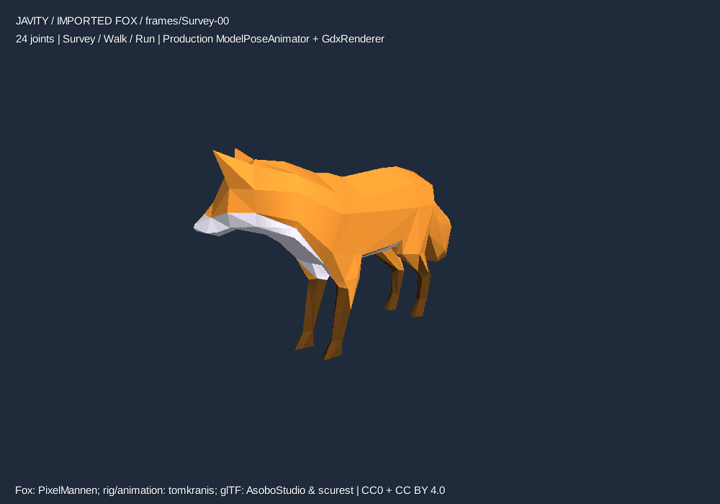

# Rzeczywisty rig: Fox

2026-10-16 — PASS na desktopowych GL20 compatibility i GL30 core, Mesa software. Model zewnętrzny, 24 kości i 1728 wierzchołków; Survey/Walk/Run. Własny `ModelPoseAnimator` i `GdxRenderer` pracują bez zmian kodu produkcyjnego.

[Trzy kadry](fox-clips.png). GIF zawiera 60 rzeczywistych klatek silnika; jest zmniejszony do720×504 z zachowaniem podpisów autorów. Czas klatek odzwierciedla czas źródłowych klipów z zaokrągleniem formatu GIF; animacja preview nie zastępuje asercji zegara.

- [Wynik GL20](gl20/verification.json), [wynik GL30](gl30/verification.json).
- [Crossfade](gl30/crossfade-mid.png), [maska ogona](gl30/tail-mask.png), [mikser50%](gl30/mixer-50.png).
- [Źródło/licencja](../../../tools/animation-validation/fox/NOTICE.md), [instrukcja testu i viewera](../../../tools/animation-validation/README.md).

Sprawdzenia: 12 próbek oryginalnego glTF ×1728 skinned vertices; każdy z trzech klipów zmienia piksele geometrii (HUD wykluczony); ciągłość/start/środek/koniec crossfade; maska ogona z izolacją innych lokalnych kości; phase-synchronous mixer; WORLD/playback pause i resume/speed2x; izolacja instancji i brak dodatkowej aktualizacji podczas renderowania; marker i completion ONCE dokładnie raz; źródłowa tekstura zwolniona przy dispose.

Maksymalny błąd względem matematycznego SLERP źródła: **0.00699997 jednostki assetu**, przy przyjętej tolerancji0.01 i skali sceny0.02. To około0.00014 jednostki świata. libGDX aproksymuje SLERP dla małych kątów, a jego helper nie zawsze normalizuje wynik; referencja blendingu jest normalizowana zgodnie z kontraktem Javity. Czas testu jest dzielony na kroki<=50ms: pojedyncze Game.step ogranicza dt do100ms. Nie zmieniano tych kontraktów, by dopasować wynik.

Ograniczenia: offline konwersja konkretnego glTF do G3DJ, nie runtime importer GLB/PBR. Nie potwierdza root motion, IK, retargetingu, klasyfikacji regionów avataru, wszystkich rigów ani Androida. Weryfikowano animacje, nie słuch, fizyczny sprzęt GPU czy pełne API Unity Animancer.

## Exact pose batching —2026-10-16

Opt-in `game.addSystem(new PoseBatchSystem(128))` shares exact local-pose compositions; playback, callbacks, nodes, sockets and skin matrices remain independently owned. The bounded scene cache resets by frame on every resolve, including immediate/UI/paused calls, and closes with the scene. Primitive live-source comparisons precede snapshot reuse, so channel edits remain visible; cached clip arrays and original bind TRS retain the existing animator semantics.

Actual GL20/GL30 cache and uncached runs both pass the original glTF oracle with unchanged 0.01 tolerance and unchanged maximum error 0.006999969482421875. 256 equal Fox owners produce **one actual composition, 255 hits and 256 independent marker events**, with bit-exact local/socket/skin matrices and skinned vertices compared with the uncached path. Only one immutable Fox clip snapshot is copied; subsequent checks compare live primitives without copying/boxing entire clips. The immutable pose view avoids per-hit pose-array clones while the public cache API still returns defensive copies.

- Cached proof: [GL20](pose-cache/gl20/verification.json), [GL30](pose-cache/gl30/verification.json).
- Current uncached proof: [GL20](task2-uncached/gl20/verification.json), [GL30](task2-uncached/gl30/verification.json).
- [Byte-identical cached/uncached PNG hashes](pose-cache/pixel-equivalence.json); duplicated screenshots omitted. Original screenshots/reports above remain unchanged.

Measured `Game.step` cost for 256 owners, 20 sequential frames after 10 warmup frames, excluding rendering/initial capture:

| Actual profile | Cached elapsed/frame | Uncached elapsed/frame | Cached allocated bytes/frame | Uncached allocated bytes/frame |
|---|---:|---:|---:|---:|
| GL20 compatibility |6.765 ms |2.607 ms |290197 |145232 |
| GL30 core |4.344 ms |2.335 ms |286925 |145232 |

These process measurements vary with JIT/scheduling. Composition sharing is proven; **total elapsed time and allocation are higher on this workload**. Live-source verification, exact keys and per-owner transforms still have costs. An initial implementation with pose-array copies allocated about 562559 bytes/frame; the immutable view reduced that to about 290197 in the final GL20 sample. No immutable-assets/trust shortcut or silent time quantization was introduced. This remains an opt-in functional batching stage, with no GPU draw-call, Android or overall performance claim. The reports identify the loaded core jar by SHA256, independently of the checkout commit.

### Retained-source compatibility fix

A malformed public key edited after lazy validation can be unused at the currently sampled endpoint or in a skipped layer. If that source cannot be represented by an immutable snapshot, caching now falls back to the original sampler; an actually used malformed value still raises its original error once. Restoring valid data resumes cache sharing in the same frame. Public strict snapshot capture validation remains unchanged.

Fix proof from production commit `900466f`: cached [GL20](pose-cache-fix1/gl20/verification.json) / [GL30](pose-cache-fix1/gl30/verification.json), uncached [GL20](task2-fix1-uncached/gl20/verification.json) / [GL30](task2-fix1-uncached/gl30/verification.json), and [PNG equivalence](pose-cache-fix1/pixel-equivalence.json). All four actual contexts pass with the same original oracle tolerance/error, one composition/255 hits/256 events, and the loaded core jar SHA256 `4be5d7f3ca7f0ee1bf165414cfe6426f295d90b030ebd7c2092b39702682c70c`. Previous evidence above is retained separately. The workload remains slower with caching: these runs measured 6.942 vs 3.607 ms/frame (GL20), 5.667 vs 4.397 ms/frame (GL30); allocation remained higher. These sequential process measurements exclude rendering and initial capture and vary with JIT/scheduling.
