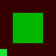

# World postprocess visual and numeric evidence

The standalone probe is run with JDK 25.0.4 and Mesa software OpenGL under the dummy Xorg server on display `:104` (the server is Xorg, not Xvfb). `:javity-desktop:postprocessSmoke` launches both a GL 3.2 readback probe and a GL20 contract probe. The successful run writes these 96×96 images and `results.json` into this directory:

- [identity.png](identity.png) — flat world color through the exact identity bypass.
- [tint.png](tint.png) — numeric half-red tint.
- [desaturation.png](desaturation.png) — full luminance desaturation.
- [vignette.png](vignette.png) — center and radial edge comparison.
- [world-viewmodel-hud.png](world-viewmodel-hud.png) — world-only tint with a green viewmodel and a distinct HUD patch drawn afterward.
- [orientation.png](orientation.png) — four asymmetric corner colors that detect vertical or horizontal inversion.
- [results.json](results.json) — expected and observed RGBA samples with tolerance, output dimensions, software renderer, and display label.




The probe asserts each recorded numeric sample before writing it. The orientation fixture is drawn into the owned world target with four quadrant scissored clears, then read after composite at matching screen coordinates. GL screenshots are Y-flipped on export for conventional top-left image viewing; sample coordinates use OpenGL's bottom-left origin.

The GL 3.2 probe also checks actual GdxRenderer callbacks and repeated passes with caller depth function `GREATER`, depth range `[0.2,0.8]`, and cull mode `FRONT`. It queries those values after each successful pass and exercises immediate caller draws whose pixels depend independently on depth function, depth range, and cull mode. The callback-exception case checks the same queried values. Positive owned framebuffer, texture, renderbuffer, program, VBO and VAO IDs are verified live before close, then each exact ID is verified deleted; a distinct borrowed array buffer is verified live and reusable afterward.

The GL20 contract verifies eligible repeated passes, prebound attribute rejection before callback invocation, and element-array binding preservation. Arbitrary GL20 client-pointer state remains outside the supported contract.

Both targeted Gradle commands passed during the fix round:

```sh
DISPLAY=:104 XDG_RUNTIME_DIR=/tmp/javity-xdg LIBGL_ALWAYS_SOFTWARE=1 ALSOFT_DRIVERS=null \
  ./gradlew :javity-desktop:postprocessSmoke --no-daemon
./gradlew :javity-core:test --tests org.javity.postprocessing.WorldPostProcessControlsTest --no-daemon
```
