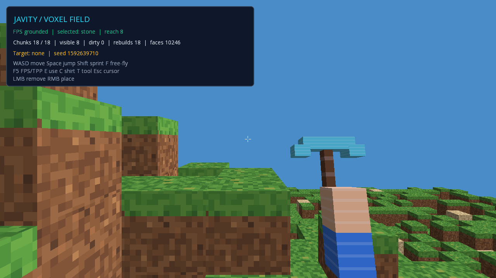
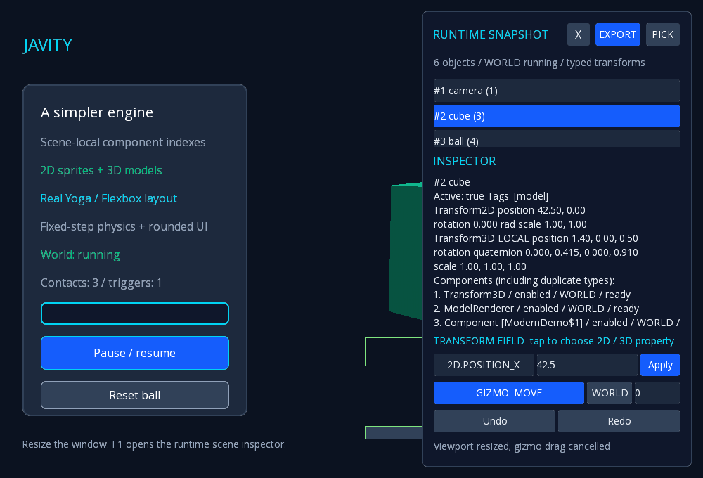

# JavityEngine — przewodnik praktyczny

Stan: 2026-10-16. Ten guide opisuje istniejące API. Projekt kolejnych funkcji jest osobno w [następnym batchu](next-runtime-batch.md); nazwy z tamtego projektu nie są jeszcze klasami silnika.

## 1. Wybierz i uruchom przykład

Wymagania desktopu: pełne JDK25 i OpenGL. Polecenia uruchamiaj z katalogu repozytorium; Gradle Wrapper pobiera właściwy Gradle.

| Cel | Polecenie |
| --- | --- |
| Świat blokowy, FPS z rękami/narzędziem, przełączany TPP | `./gradlew :javity-desktop:run --args='--voxels'` |
| Ten sam rodzaj gry z opcjonalną fizyką Bullet | `./gradlew :javity-desktop:run --args='--physics3d'` |
| Drzewo obiektów, komponenty, transformacje i gizma | `./gradlew :javity-desktop:run --args='--inspector'` |
| Feedback, zegary, scena i React HUD | `./gradlew :javity-desktop:run --args='--mm'` |
| Prezentacyjne efekty kamery/modelu 3D | `./gradlew :javity-desktop:feel3d` |
| Porównanie kontrolek z HTML | `./gradlew :javity-desktop:run --args='--ui-parity'` |

**Voxele:** WASD — ruch, mysz — rozglądanie, Space — skok, Shift — sprint, F5 — FPS/TPP, E — animacja użycia, T — pokaż/ukryj narzędzie, C — ubranie, F — lot debugowy, Escape — kursor, LMB/RMB — usuń/dodaj blok. Narzędzie w tym przykładzie jest obecnie prostym proceduralnym modelem; nie jest jeszcze czytelnym kilofem z dopracowaną pozą dłoni. Android ma osobny launcher i demo dotykowe, nie ten desktopowy avatar FPS: [instrukcja Androida](../javity-android-app/README.md).



To rzeczywisty zrzut istniejącego renderera, nie makieta docelowego wyglądu. Postać ma jeden animator, a `AvatarView` wybiera części widoczne w danej kamerze. Pass viewmodelu ma osobny depth i projekcję; ręce nie znikają wewnątrz ściany. [Konfiguracja avatarów i ograniczenia](avatars.md#fpstpp-voxel-demo-task-4c).

## 2. Scena i komponenty

Nowy gameplay opiera się na `org.javity.core.Game`, `GameObject` i `Component`. Legacy Galaxy Rapid/Artemis pozostają adapterami migracyjnymi. Nie potrzebujesz encji Artemis do nowej gry.

```java
Game game = new Game();
GameObject player = game.createObject("Player");
Transform3D transform = player.addComponent(new Transform3D());
transform.position.set(0, 2, 4);
game.start();
// Każda klatka: game.step(deltaSeconds).
// Koniec życia sceny: game.close().
```

Dodaj importy `org.javity.core.Game`, `GameObject`, `Transform3D`. Wiele komponentów tego samego typu jest dozwolone. `getComponent(Type)` zwraca pierwszy zgodny albo null, `getComponents(Type)` wszystkie zgodne, `hasComponent(Type)` obecność. Przy potrzebie pobrania użyj jednego `getComponent` i sprawdzenia null. `requireComponent` służy sprawdzeniu konfiguracji, nie sterowaniu ruchem przez wyjątki.

Systemy (`GameSystem`) dodawaj przed `start()`. Komponenty dodane później inicjalizuje następny krok gry. `Transform3D` ma pozycję, quaternion i skalę; Transform2D każdego obiektu nie zastępuje transformacji 3D. Wybierz jednego właściciela ruchu: controller albo fizyka. Inspektor respektuje `TransformEditPolicy` i nie teleportuje brył przez bezpośredni zapis transformacji.

## 3. Tree viewer i gizma

Uruchom `--inspector`, a potem użyj F1 do otwierania i zamykania panelu. Ten przełącznik działa również w podstawowym ModernDemo. Nie jest obecnie wpięty do `--voxels`, `--physics3d` ani launchera Androida.



Panel pokazuje obiekty aktywne i nieaktywne, hierarchię pierwszego Transform3D oraz wszystkie komponenty, także wyłączone i powtórzone. Hierarchia 2D pozostaje płaska. Wybierz obiekt, zmień typowane pola i kliknij Apply. Undo/redo ma 256 wpisów. Przyciski MOVE/ROTATE/SCALE oraz LOCAL/WORLD i pole snapu sterują uchwytami osi; jeden drag tworzy jedną operację historii. Kontrolki UI mają pierwszeństwo przed światem. Focus loss, zmiana sceny/kamery lub resize anuluje podgląd przeciągania.

Do własnego hosta przekaż aktualną scenę przez Supplier<Game>, kamery przez `setGizmoCameras`, ustaw kolejność wejścia inspector → Stage → gizma → gameplay i rysuj gizma między światem a Stage. [Pełny przykład integracji, ograniczenia rodziców i eksport](runtime-tools.md).

Eksport wymaga jawnego `SceneJson`, codeców zasobów i ścieżki. Snapshot nie jest automatycznym zapisem projektu; nieznany komponent blokuje zapis zamiast znikać z pliku. `--scene-export=/absolute/path/runtime-scene.json` działa w ModernDemo.

## 4. Ładowanie zasobów podczas gry — działa już teraz

`SceneAssets` posiada libGDX `AssetManager`. `queueSceneAssets` kolejkuje pracę, `update(budgetMillis)` posuwa ją naprzód, a `get` pobiera wyłącznie gotowy zasób. Operacje managera wykonuj na wątku renderującym; loader może przygotowywać część danych asynchronicznie, a upload GPU kończy się na tym wątku. Budżet jest miękki: pojedynczy upload/loader może potrwać dłużej.

Poniższy kompletny przykład wymaga własnego pliku modelu pod przekazaną ścieżką internal (G3DB/G3DJ/OBJ). Nie jest on dołączonym assetem gry. Utwórz obiekt dopiero po inicjalizacji libGDX, np. w `ApplicationListener.create()`, wywołuj `frame` z render i `close` z dispose. Host odpowiada za resize oraz czyszczenie framebufferu przed renderem.

```java
import com.badlogic.gdx.graphics.g3d.Model;
import org.javity.core.Game;
import org.javity.core.GameObject;
import org.javity.core.Transform3D;
import org.javity.render.Camera3D;
import org.javity.render.GdxRenderer;
import org.javity.render.ModelRenderer;
import org.javity.services.AssetSpec;
import org.javity.services.SceneAssets;

public final class AsyncModelExample implements AutoCloseable {
  private final Game game = new Game();
  private final SceneAssets assets = game.addSystem(new SceneAssets());
  private final GdxRenderer renderer = new GdxRenderer();
  private final String path;
  private boolean attached;

  public AsyncModelExample(String path) {
    this.path = path;
    assets.queueSceneAssets(new AssetSpec<>(path, Model.class));
    GameObject camera = game.createObject("Camera");
    camera.addComponent(new Transform3D()).position.set(0, 2, 6);
    camera.addComponent(new Camera3D(67));
    game.start();
  }

  public void frame(float deltaSeconds) {
    if (!attached && assets.update(2)) {
      GameObject model = game.createObject("Loaded model");
      model.addComponent(new Transform3D());
      model.addComponent(new ModelRenderer(assets.get(path, Model.class)));
      attached = true;
    }
    game.step(deltaSeconds);
    renderer.render(game);
  }

  public void resize(int width, int height) {
    renderer.resize(width, height);
  }

  @Override public void close() {
    try { game.close(); } finally { renderer.dispose(); }
  }
}
```

Nie wywołuj `load()` ani `finishLoading()` w głównej pętli, jeśli zależy Ci na ładowaniu etapowym: te API blokują. Zwrócony Model jest pożyczony — komponent go nie zwalnia. `SceneAssets` zamyka zasoby po komponentach przy zamknięciu Game. `unload(path)` jest bezpieczne dopiero po odłączeniu wszystkich użytkowników modelu/tekstury i zakończeniu rysowania. Nie niszcz zasobu, którego używa ModelInstance lub bieżący batch.

`progress()` jest monotoniczne dla życia SceneAssets; po zakończeniu pierwszej partii nie jest procentem nowej partii. Gotowość tej partii sprawdzaj wynikiem `update`, a poszczególny plik przez `assetManager().isLoaded`. Wskaźnik nie jest licznikiem bajtów ani zużyciem GPU.

To nie jest jeszcze pełny system streamingu świata: brak automatycznej eksmisji, własnych lease'ów konsumentów, priorytetów i granic pamięci. HTTP oraz hot reload nie włączają się automatycznie. `AssetSceneLoadJob` + `SceneManager.requestLoading` obsługują osobny przypadek: przygotowanie nowej sceny, anulowanie kandydata i kontrolowaną podmianę. [Przewodnik usług](game-authoring.md), [projekt streamingu](next-runtime-batch.md).

## 5. Feedback, animacje, UI

Do tweenów i kompozycji użyj `EffectSystem`, `FeedbackPlayer` i niemutowalnych opisów `Feedback.sequence/parallel`. Zasoby dźwięku/freeze/efektu mają uchwyty; anulowanie zwalnia uchwyty tego playbacku. WORLD podlega pauzie, UI używa czasu nieskalowanego. [Przykłady](feedback-api.md).

`PresentationEffects3D` daje modelom i kamerom punch, shake, recoil, bob i FOV. Nie przesuwa fizyki ani stanu gameplay. Świat i viewmodel mają osobne powierzchnie prezentacji. [Presety i konfiguracja](feel3d.md), [particles](particles3d.md), [world postprocess](world-postprocess.md).

`ModelPoseAnimator` obsługuje klipy, warstwy, maski i crossfade. Widoczność części avataru nie usuwa kości potrzebnych socketom. [Animacje](animation-api.md), [avatary](avatars.md). Są to własne odpowiedniki wybranych zachowań Animancer/Feel, bez deklaracji pełnego API Unity.

UI jest opcjonalne: Scene2D/Yoga bez JS albo React/TSX na wspólnym hoście. Zwykły JDK25 + GraalJS działa na desktopie, QuickJS na Androidzie; nie potrzebujesz dystrybucji GraalVM. Katalog UtilityStyles jest ograniczony i jawny, nie pełny HTML/CSS/Tailwind. [TSX i hot reload UI](onejs-port.md), [porównanie HTML](ui-html-parity.md).

## 6. Światło i tło — aktualny stan

`GdxRenderer.environment` udostępnia libGDX Environment z domyślnym ambient i DirectionalLight. Host może zmienić ambient i kierunek światła przez API libGDX. Nie ma jeszcze scene-local komponentów świateł ani skyboxa; płaski kolor czyszczenia ekranu w voxelowym demie nie jest skyboxem. Liczby świateł i możliwości shaderów wymagają jawnej konfiguracji. Nowy projekt obejmuje komponenty, cubemap i mgłę: [następny batch](next-runtime-batch.md).

## 7. Jak sprawdzać własną zmianę

`./gradlew build` sprawdza reactor desktopowy. `voxelSmoke`, `inspectorSmoke`, `avatarSmoke`, `avatarGl30Smoke` i `feel3dSmoke` wymagają rzeczywistego OpenGL. Kompilacja ani test headless nie dowodzą widoczności rąk, światła lub shaderów. [Aktualne dowody Androida](android-status.md) rozdzielają testy CPU, JNI, piksele, lifecycle i ograniczenia sprzętu. [Indeks pozostałych instrukcji](README.md).


## 8. Darmowy model z prawdziwymi animacjami

`python3 tools/animation-validation/run.py --interactive` otwiera Fox z trzema importowanymi klipami: 1 Survey, 2 Walk, 3 Run, 4 crossfade, 5 mikser50%, 6 maska ogona, Space pauza. [GIF i wyniki](artifacts/imported-animation/README.md), [instrukcja i licencja](../tools/animation-validation/README.md). `run.py` bez `--interactive` wykonuje asercje i zamyka aplikację; `--gl30` wybiera drugi testowany profil. Model jest lokalnym fixture G3DJ przekonwertowanym z glTF, więc nie oznacza to nowego loadera GLB w runtime.


## 9. Instancing modeli i animowanych tłumów

[Jak włączyć InstancedModel, skonfigurować Fox24/4 i zarządzać lifecycle](gpu-instancing-guide.md). GPU palette skinning działa z niezależnymi pozami; cache CPU jest osobnym opt-in ze zmierzonym narzutem. [Benchmark, porównania i granice Androida](artifacts/instancing/README.md).
