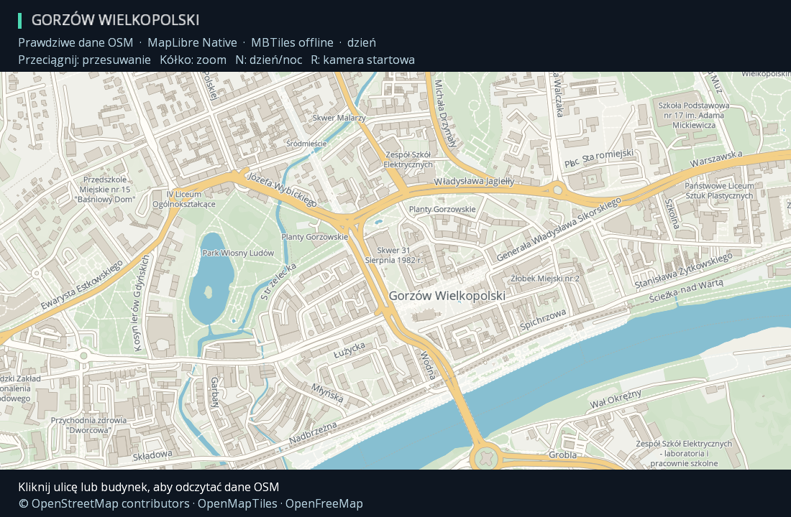

# Gorzów Wielkopolski — rzeczywista mapa offline

Demo wyświetla centrum Gorzowa i sąsiednie obszary na prawdziwych danych OpenStreetMap, pobranych jako MVT ze źródła OpenFreeMap/OpenMapTiles. Geometria ulic, budynków, Warty i terenów zielonych pochodzi z tych kafelków; nie jest syntetycznym rysunkiem ani samym podpisem miasta.



```sh
./gradlew :javity-desktop:run --args='--gorzow'
./gradlew :javity-desktop:gorzowSmoke
```

Wymagania jak dla [MapLibre Native](maplibre-native.md): zwykłe JDK 25, Linux x64 i system EGL/GLES. Przy uruchomieniu wszystkie dane, style i czcionki są lokalne. Renderer to rzeczywisty MapLibre Native, obraz trafia do okna libGDX jako współdzielona tekstura GPU.

Sterowanie: przeciąganie przesuwa mapę, kółko zmienia zoom wokół kursora, `N` przełącza dzień/noc, `R` przywraca kamerę, kliknięcie ulicy lub budynku odczytuje dane feature.

## Dane i zakres

- Kamera początkowa: longitude **15.2385**, latitude **52.7319**, zoom **15**.
- **38 kafelków**: 25 na z14 (5×5), 9 na z13 i 4 na z12. To pakiet demonstracyjny centrum i okolic, nie mapa całej Polski; poza zasięgiem danych pojawia się tło stylu.
- Przypięty snapshot: `https://tiles.openfreemap.org/planet/20261011_080001_pt/{z}/{x}/{y}.pbf`, schemat OpenMapTiles 3.16.0.
- Oryginalne payloady MVT zachowano, w MBTiles mają jedynie deterministyczną kompresję gzip. XYZ dostawcy jest zapisane jako standardowy wiersz TMS.
- Baza ma około 2 MB. `fixture-source.json` zawiera SHA-256 oryginalnych kafelków i dołączonych plików, liczniki instancji features według warstw/zoomów oraz zaobserwowane nazwy. Liczniki między zoomami mogą obejmować te same obiekty.
- Lokalne Open Sans SDF: 0–255, 256–511 oraz **8192–8447**. Ostatni zakres jest potrzebny dla typograficznych znaków w prawdziwych etykietach OSM. Nagłówki UI używają dołączonego Open Sans FreeType.

Widok zawiera m.in. Park Wiosny Ludów, katedrę, Planty Gorzowskie, ul. Generała Władysława Sikorskiego i Wartę. [Tryb nocny](demo-gorzow-night.png), [mapa bez HUD](demo-gorzow-map.png).

## Licencja i reprodukcja

Widoczna atrybucja: **© OpenStreetMap contributors · OpenMapTiles · OpenFreeMap**. Dane OSM są pod ODbL 1.0; pełny tekst i notice znajdują się w pakiecie mapy. Style dzień/noc są własnymi stylami Javity na Apache-2.0. Font zachowuje swoją licencję. Szczegóły: [THIRD_PARTY.md](../THIRD_PARTY.md).

```sh
# Pobranie ograniczonego, przypiętego zestawu kafelków i budowa MBTiles:
python3 tools/import-gorzow-map.py

# Ponowna budowa wyłącznie z istniejącego cache, bez sieci:
python3 tools/import-gorzow-map.py --offline

# Własny katalog cache:
python3 tools/import-gorzow-map.py --cache /path/to/cache
```

Importer korzysta z biblioteki standardowej Pythona, ma ograniczenie footprintu, rozmiaru odpowiedzi, liczby workerów i czasu pobierania. Nie pobiera standardowych rastrowych kafelków OSM. Build/uruchomienie gry nie wywołuje importera ani sieci; pakiet jest w zasobach dystrybucji.

`BundledOfflineMap` przed rozpakowaniem sprawdza indeks plików, ścieżki, SHA-256 i limity rozmiaru; posiada prywatny katalog tymczasowy. `MapLibreMap` trzeba zamknąć przed usunięciem tego katalogu i okna GL.

## Weryfikacja

`gorzowSmoke` sprawdza prawdziwy Native/EGL, położenie kamery, zapytania o wyrenderowane budynki i drogi, zgodność geometrii wody z jej pikselami, nazwy z danych MVT, dzień/noc, pan/zoom oraz zwolnienie tekstury. Sprawdza też, że źródłowa baza nie zmieniła się po zamknięciu.

[Dowód uruchomienia](gorzow-verification.json) zapisuje liczbę trafień zapytań (nie liczbę unikalnych obiektów), przykładowe odczytane nazwy i wyniki cleanup. Testy CPU importera nie wymagają internetu; używają małych danych kontrolnych do sprawdzenia TMS/gzip, cache, granic pobierania, stylów, licencji i deterministyczności. Osobne testy loadera sprawdzają prawdziwy pakiet Gorzowa oraz brakujące/uszkodzone zasoby i sprzątanie po błędzie.

## Komponenty jak w java-lab

[Audyt przypiętego API java-lab](java-lab-component-parity.md) opisuje zgodność podstaw `GameObject`/`Component` oraz różnice w fizyce, UI, wejściu i tweenach. Nie deklarujemy identyczności nazw i zachowań całego API.

Ta mapa korzysta z obecnego `MapLibreMap` w `ApplicationAdapter`. Nie jest jeszcze gotowym komponentem sceny; istniejące `MapView`/`MapMarker`/`MapRoute` są komponentami **rastrowego** modułu. Cienki adapter natywnej mapy do cyklu życia sceny pozostaje jawnym dalszym krokiem.

Końcowa weryfikacja tego etapu: cały reactor przeszedł (384 JUnit, 0 failures/errors/skips), 12 testów narzędzi Python, `gorzowSmoke` i regresja `maplibreSmoke`. Zainstalowany launcher `--gorzow --smoke` działał poza checkoutem, a ZIP i obecność danych/glyphów/licencji sprawdzono osobno. Zdalnego CI nie uruchamiano.

## Warstwy dróg i etykiety

Styl rozdziela tunele, ruch naziemny oraz mosty. Poziom `layer` ma pierwszeństwo przed klasą drogi; w ramach poziomu drogi główne przykrywają poboczne. Most zachowuje kolor swojej klasy i osobny obrys, tunele mają przygaszone wypełnienie oraz przerywany obrys. Ścieżki i kolej nie są ponownie rysowane ponad wszystkimi mostami. Przypadki `layer` poza −5..5 trafiają do skrajnych kubełków zamiast znikać.

Etykiety korzystają ze wspólnej detekcji kolizji MapLibre, większego odstępu i pierwszeństwa ulic przed POI. POI mogą dobrać inne zakotwiczenie, a nazwy ulic mają ograniczony kąt łamania. Filtry przyjmują również obiekty z samym `name:pl`. Zakresy fontu obejmują polskie litery i typograficzną interpunkcję; nazwa może zostać ukryta w całości przez kolizję, ale nie zastępujemy liter uproszczonym ASCII.

Porównanie rzeczywistego pakietu w Native i GL JS: [dzień/noc](gorzow-comparison.png), [pomiary](gorzow-render-comparison.json). Różnice w rozmieszczaniu napisów i antyaliasingu pozostają; to nie deklaracja identyczności rendererów. Odtworzenie referencji: `python3 tools/maplibre-browser-reference.py --package javity-desktop/src/main/resources/org/javity/demo/maplibre-gorzow --capture --screenshot docs/demo-gorzow-reference.png`.
