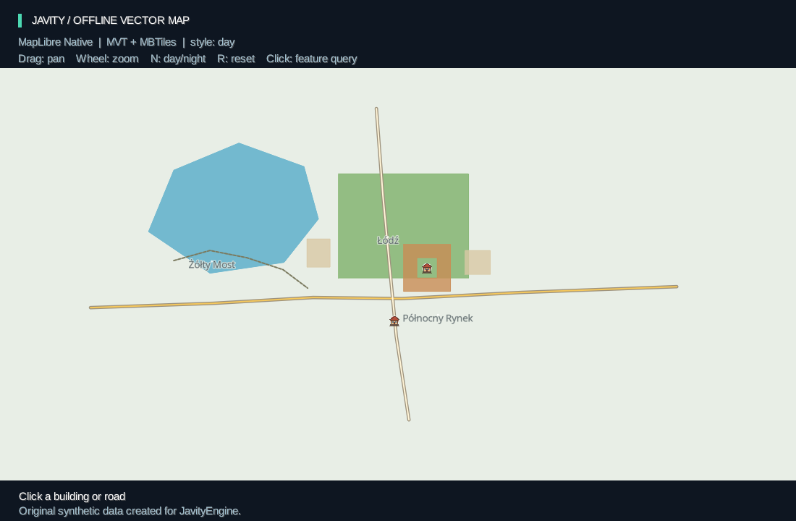

# MapLibre Native i własne mapy offline

`javity-maplibre` używa rzeczywistego MapLibre Native przez FFI **0.202610.0**. Nie tłumaczy stylów na własny renderer. Gra/aplikacja dostarcza własny MBTiles z geometrią MVT, standardowy styl MapLibre v8, sprites i glyphy; Native rysuje do tekstury GPU, którą libGDX składa z resztą widoku. Raster `javity-map-core` pozostaje oddzielnym, lżejszym modułem.

## Uruchomienie

Pierwszy backend obsługuje **Linux x64, system EGL/GLES**; sprawdzono Mesa/llvmpipe, OpenGL ES 3.2. Potrzebne JDK 25 oraz systemowe biblioteki EGL/GLES (w Debianie/Ubuntu: `libegl1`, `libgles2`, odpowiedni sterownik Mesa/GPU). Nie ma tu wymogu GraalVM. Niewielki wewnętrzny most Kotlin obsługuje typy wartościowe FFI, publiczne API jest w Javie.

```sh
./gradlew :javity-desktop:run --args='--maplibre'
./gradlew :javity-desktop:maplibreSmoke
```

Demo: przeciąganie przesuwa mapę, kółko zmienia zoom wokół kursora, `N` przełącza dzień/noc, `R` przywraca kamerę, kliknięcie pobiera dane feature. Miasteczko, ikony i nazwy są autorskie; nie korzysta z OSM ani internetu. Jedna kanoniczna geometria z14 jest powiększana przez Native, początkowy zoom wynosi 16. Zasięg danych jest celowo mały; poza nim pozostaje tło stylu.



## Pakiet mapy

```text
my-map/
  map.json
  style-day.json
  style-night.json
  town.mbtiles
  sprites/town.json, town.png, town@2x.json, town@2x.png
  glyphs/Open Sans Regular/0-255.pbf, 256-511.pbf
  licenses/
```

Minimalny manifest:

```json
{
  "version": 1,
  "styles": {"day": "style-day.json", "night": "style-night.json"},
  "defaultStyle": "day",
  "sources": {"town": "town.mbtiles"},
  "initialCamera": {"longitude": 21, "latitude": 52, "zoom": 16},
  "attribution": "Autor danych / wymagane informacje licencyjne"
}
```

W źródle stylu: `{"type":"vector","url":"mbtiles://@town"}`. Loader podmienia tylko zasoby pakietu na lokalne URL; Native interpretuje warstwy, expressions i filtry. `sprite` wskazuje `sprites/town`, a `glyphs`: `glyphs/{fontstack}/{range}.pbf`. Kopiowanie katalogu nie wymaga edycji absolutnych ścieżek. Standardowy MBTiles ma tabele `metadata`/`tiles`, `format=pbf`, opis `vector_layers` i wiersze TMS; Native czyta także gzip MVT.

Loader ogranicza JSON do 2 MiB, sprawdza nagłówek SQLite, wersje, kamerę, istnienie zasobów i ścieżki. Nie otwiera bazy do zapisu. Kamera: longitude ±180, szerokość Web Mercator, zoom 0–22, pitch 0–60. Źródła/zasoby HTTP i wyjście poza katalog pakietu są odrzucane. Drzewa zasobów z szablonami mają limit 10 000 wpisów i nie mogą zawierać symlinków. Nie jest to pełny walidator Style Spec ani schematu SQL; błędy danych/stylu nadal może zgłosić Native.

Upstream ustawia dostępność sieci **globalnie dla procesu**. Moduł wymusza OFFLINE; nie jest to osobny firewall dla każdej mapy. W tej wersji nie ma trybu map sieciowych ani przełącznika współdzielonego stanu sieci.

## API Java

Przed utworzeniem `Lwjgl3Application`:

```java
MapLibreDesktop.configure(config);
```

W `create()` aplikacji, na wątku GL:

```java
var mapPackage = OfflineMapPackage.open(Path.of("my-map"));
var map = new MapLibreMap(mapPackage, width, height, pixelRatio);
```

W `render()`, poza aktywnym Batch, z ortograficzną projekcją w logicznych pikselach:

```java
map.update();
batch.begin();
map.draw(batch, 0, 0, width, height);
// Następnie zwykłe UI/libGDX.
batch.end();
```

Dostępne: `jumpTo`, `camera`, `panBy`, `zoomBy` z kotwicą, `pixelFor`/`coordinateFor`, `setStyle`, `setLayerProperty`, `setLayerFilter`, `setFeatureState`, `query`. Query zwraca kopie GeoJSON/state i source/source-layer. **Współrzędne projekcji, kotwicy i query mają początek u góry**, w logicznych pikselach mapy; destination `draw` pozostaje w układzie caller Batch. Przy rysowaniu w podprostokącie trzeba przeliczyć pozycję wejścia na viewport mapy.

Zmiany stylu/stanu docierają do renderera przez następne `update()`. Query dotyczy ostatniej wyrenderowanej klatki, więc nie należy oczekiwać nowego feature-state natychmiast po setterze. Zmiana całego stylu resetuje lokalne imperative overrides i śledzone feature-state. Nie tworzymy GameObject dla każdego kafelka lub feature; aplikacja może powiązać wybrane ID z własnymi obiektami gry.

`resize(width,height,pixelRatio)` zmienia rozmiar. Native ustala pixel ratio przy tworzeniu mapy, więc zmiana DPI odtwarza jej natywne uchwyty. Adapter zachowuje kamerę i zmiany właściwości/filtrów/feature-state wykonane przez swoje API; zmiana zwykłego rozmiaru zachowuje istniejący renderer. Może wystąpić krótka przerwa do następnej gotowej klatki.

Wszystkie operacje i `close()` muszą działać na wątku właściciela z bieżącym oknem hosta. Zamknij mapę **przed** oknem GL. MapLibreMap posiada runtime/map/session, pożycza okno i Batch. Nie zamyka Batch. Frame tekstury żyje do `batch.flush`; fence GPU zabezpiecza ponowny zapis/resize/teardown. Kompozycja używa premultiplied alpha i przywraca kolor/blending Batch. `close()` jest idempotentne, a nieudane zwalnianie uchwytu można ponowić.

## Zgodność i ograniczenia

| Funkcja | Zakres |
| --- | --- |
| Style JSON v8, sources/layers/expressions/filters | interpretuje prawdziwy Native; fixture sprawdza fill/line/circle/symbol, match/interpolate i filtry |
| MBTiles/MVT, TMS/gzip, wielokąty z otworami | lokalny pakiet i oryginalne dane demo |
| Kreskowane linie | `line-dasharray` Native; niezależne od kreskowania komponentów Shapes |
| Ikony i etykiety | lokalne sprites 1×/2× oraz Open Sans SDF, w tym polskie znaki |
| Kamera i picking | pan/zoom, projekcja/odwrotna projekcja, rendered-feature query i feature-state |
| Własne shadery/custom layers GL JS | FFI nie udostępnia pełnego kontraktu, brak takiej zgodności |
| Android, Windows, macOS, web backend silnika | nie są objęte tym adapterem ani jego weryfikacją |
| DOM/WebGL JavaScript MapLibre | nie jest osadzany w grze; GL JS służy wyłącznie jako referencja testowa |

FFI ma eksperymentalne ABI 0; binding i natywny runtime są przypięte do tej samej wersji. Aktualizacja wymaga powtórzenia testów binarnych i GPU. Tryb EGL/GLES jest jawny; nie zmieniamy po cichu dotychczasowych demonstracji GLX/OpenGL. Kod Shapes z GLSL 1.20 wymaga osobnego portu do GLES, zanim będzie można go łączyć z tym oknem. To nie deklaracja pełnej zgodności z każdą funkcją GL JS.

## Reprodukcja i dowody

- `python3 tools/generate-maplibre-town.py`: deterministyczny pakiet, wyłącznie standardowa biblioteka Pythona.
- `python3 tools/generate-maplibre-glyphs.py`: regeneracja prebuilt glyphów z dołączonego TTF, wymaga Pillow/NumPy/SciPy; gra nie wymaga tych narzędzi.
- `python3 -m unittest tools.test_generate_maplibre_town tools.test_generate_maplibre_glyphs`: niezależny od Native odczyt MVT/PBF, TMS/gzip, winding/otwory i deterministyczność.
- `:javity-maplibre:test`: loader i błędne pakiety/ścieżki/kamery.
- `:javity-desktop:maplibreSmoke`: prawdziwy kontekst EGL, piksele mapy, query/state, kamera, style, alpha, resize/DPI i zwolnienie tekstury. [Wynik](maplibre-verification.json).
- `cd web/maplibre-reference && npm ci --ignore-scripts --no-audit --no-fund`, następnie z root repo `python3 tools/maplibre-browser-reference.py --capture`: GL JS 6.14.0, ten sam MBTiles/styl/kamera. Lokalny serwer testowy czyta SQLite readonly i wystawia MVT po XYZ; nie jest runtime gry.

[Mapa Native bez HUD](demo-maplibre-map.png), [referencja GL JS](demo-maplibre-reference.png), [Native noc](demo-maplibre-night-map.png), [GL JS noc](demo-maplibre-reference-night.png). Silniki mają różne rasteryzery i antyaliasing; nie zakładamy identyczności każdego piksela.

Licencje i pochodzenie: [THIRD_PARTY.md](../THIRD_PARTY.md); dokładne notices dystrybucji Native są w `META-INF/licenses/maplibre-native-0.202610.0` modułu i w oryginalnym runtime JAR.

Porównanie bieżącego fixture: dzień/noc ma odpowiednio 99,63%/99,61% pikseli RGB w tolerancji ±3/255; pokrycie foreground IoU wynosi 98,94%/99,01%. Kolory stawu są identyczne, granice foreground pokrywają się. Metryka całego obrazu obejmuje też jednolite tło; IoU oddzielnie sprawdza zasięg narysowanej geometrii. [Dokładne metryki i hashe](maplibre-render-comparison.json), [zestawienie obrazów](maplibre-comparison.png). To wynik dwóch autorskich stylów, nie test całej specyfikacji MapLibre.
