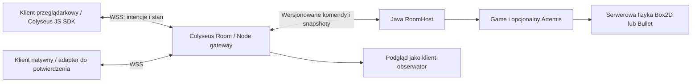

# Pokoje Colyseus, autorytatywna Java i klient przeglądarkowy

**Status: rekomendacja po audycie, nie wdrożone multiplayer ani target Wasm.** Użytkownik potwierdził, że „LeagueSu” oznacza Colyseus. Opcjonalny Artemis ma własny zaakceptowany projekt i osobny plan wykonania; ten dokument nie rozszerza jego implementacji o cały netcode.

## Rekomendacja

Zachować Game/Component/Artemis i fizykę po stronie autorytatywnej symulacji Java. Colyseus uruchamiać jako Node gateway zarządzający pokojami, połączeniami i lustrzanym DTO stanu dla swoich klientów. Procesy komunikują się wersjonowanymi wiadomościami, nie referencjami Java/JS.

Java jest jedynym autorem wynikowego gameplay i fizyki. Node waliduje/przekazuje komendy i kopiuje zatwierdzony snapshot do Colyseus Schema. Nie symuluje jednocześnie tej samej fizyki. Klient wysyła intencję ruchu/akcji; pozycja przesłana przez klienta nie staje się autorytatywnym stanem.

Podgląd to okno/klient sceny odtwarzający snapshoty. Nie wywołuje drugiego Game.step na autorytatywnej scenie i nie jest właścicielem pokoju. Jego zamknięcie nie kończy serwera; zatrzymanie pokoju to jawna operacja hosta. Headless RoomHost nie inicjalizuje rendererów, fontów, audio ani GL.

## Dlaczego taka granica

| Wariant | Zaleta | Koszt |
| --- | --- | --- |
| **Java authority + Colyseus gateway** | Wykorzystuje nasze komponenty i natywną fizykę, daje Colyseus Rooms dla przeglądarki | Dwa runtime, protokół Java–Node, kopia DTO i własny worker supervisor |
| Java authority + własny WSS/rooms | Jeden runtime serwera, mało interopu | Matchmaking/room lifecycle/reconnect trzeba utrzymać samodzielnie; nie jest to implementacja Colyseus Rooms |
| Colyseus TS jako authority | Najprostszy serwer w ekosystemie Colyseus | Portowanie/dublowanie reguł i fizyki Java; obecnego Bullet/Box2D nie współdzielimy automatycznie |

GraalJS nie zmienia serwera Node w bibliotekę in-process. Oficjalne materiały Colyseus pokazują Node/Bun, pokoje i klientów JS. Obsługa natywnego klienta Java jest osobną bramką: nie znaleziono potwierdzonego oficjalnego repo `colyseus/colyseus-java`; 404 nie dowodzi braku innych implementacji. Katalog SDK ma m.in. JS i native C. Nie obiecujemy, że Java WebSocket klient automatycznie obsłuży protokół/Schema Colyseus. Najpierw test interoperacyjności danej wersji klienta; ewentualna własna bramka DTO ma być nazwana własnym protokołem.

## Jeden lokalny i produkcyjny flow

Docelowy developer workflow: start usług lokalnych → create/join pokoju → uruchomienie klientów/obserwatora → kontrolowane stop. Localhost używa tego samego gateway i protokołu co host produkcyjny; bez skrótu omijającego walidację authority. To opis projektowanego flow, nie dostępne dziś zadanie Gradle.

Pierwszy vertical slice: jeden Java worker i jeden Colyseus room, dwóch klientów w przeglądarce/Playground, ruch/akcje i stan, late join, leave/reconnect i cleanup pokoju. Serwerowa fizyka jest sprawdzana w headless workerze osobno; pierwszy payload może być prosty, aby dowieść interopu zanim przeniesiemy całą scenę FPS.

Docelowo jeden RoomHost może obsługiwać wiele niezależnych Game/World z kolejkami wejścia i stałym przypisaniem do owner thread. Nie potrzeba JVM na każdy lekki pokój; początkowy pojedynczy worker upraszcza proof. Liczba pokoi na proces i izolacja ciężkich gier zależą od pomiaru RAM/tick oraz modelu platformy. Współdzielenie JVM nie oznacza izolacji dowolnego zewnętrznego kodu; MVP zakłada zaufany kod własnych gier.

## Minimalne kontrakty przyszłego netcode

- Room ma własny clock/tick i scene/physics ownership; delta nie pochodzi z okna klienta. Kandydat: sim60Hz/snapshot20Hz do zweryfikowania pomiarem, nie obecna gwarancja.
- Osobne network ID/room epoch/generacja; lokalne GameObject.id ani entityId nie są tożsamością sieciową. 64-bit IDs muszą mieć reprezentację bez utraty precyzji w JS, np. string.
- Jawne role Server/Client/Shared dla fabryk komponentów i prefabów: headless nie ładuje ModelRenderer/UiTheme przy starcie. Nie usuwamy nieznanych komponentów po cichu z istniejącego SceneJson.
- Jawnie wybrane replikowane pola i codeki. Encje/GameObjecty są modelami symulacji; po sieci przesyłamy DTO, nie surowe obiekty/refleksyjny graf ani pamięć fizyki.
- Walidacja intencji, sequence/ack, ownership i limitów kroku; spawn/despawn i pełny baseline dla late join. Serwer rozstrzyga fizykę.
- Najpierw snapshoty i interpolacja. Prediction/reconciliation dla wybranego kontrolera dopiero po osobnym projekcie. Stały krok nie daje deterministycznego lockstep Box2D/Bullet między platformami.
- Zamknięcie pokoju kończy input/tick, odłącza klientów i sprząta native physics/systemy na owner thread. Wiele pokoi nie współdzieli mutable GameObjects.
- Room platform nie wymaga Artemisa; ten sam host działa ze zwykłymi komponentami lub opcjonalnym ECS.

## Hosting

Najbezpieczniejszym założeniem jest własny host/kontenery uruchamiające Node i Javę oraz ich natywne biblioteki. Możliwość uruchamiania Java workerów przez Colyseus Cloud nie jest potwierdzona; trzeba sprawdzić ofertę i dopuszczone połączenia/sidecary. Nie deklarujemy wdrożenia ani wsparcia platform na podstawie dokumentacji Node.

## Browser: JavaScript a WebAssembly

**Technicznie możemy przygotować oba targety przez TeaVM/gdx-teavm. Repo obecnie nie zawiera działającego targetu przeglądarkowego.**

- Standardowy backend libGDX GWT/HTML generuje JavaScript. Historyczny generator tego repo ma przestarzały szablon Java1.6/GWT2.8/libGDX1.9.6, nie aktualny build silnika.
- Oficjalna tabela gdx-teavm podaje released pairing **gdx-teavm1.6.1 + libGDX1.14.2 + TeaVM0.15.0** i osobne `js {}` / `wasm {}`. TeaVM0.13 ogłasza obsługę Java25; nie oznacza to zgodności wszystkich użytych JDK APIs/bibliotek/refleksji.
- Wasm GC generuje prawdziwy moduł WebAssembly oraz JS loader/runtime/interop. Nie kompiluje automatycznie JNI/LWJGL/Graal do przeglądarki.
- Pierwszy proof: ta sama minimalna scena Java core w TeaVM JS, następnie Wasm GC. Można też spróbować Wasm GC bezpośrednio, lecz JS ułatwia diagnostykę i integrację Colyseus.
- Przeglądarkowy klient używa WSS/JS SDK przez jawny JS interop. Multiplayer działa także z targetem JS; Wasm nie jest jego warunkiem. Serwer może zostać zwykłym JVM.

### Adaptery wymagające osobnego wdrożenia

| Obecny element | Browser target |
| --- | --- |
| LWJGL/GLFW i desktop GL | Backend web/WebGL2 i faktyczne testy shaderów, input/resize/audio |
| Bullet JNI | Oddzielny browser physics adapter albo wyłącznie physics authority na serwerze; prediction klienta osobnym problemem |
| Box2D JNI | Oddzielny web backend/binding, nie dowód zgodności z samych nazw API |
| Yoga JNI | Browser provider Yoga lub świadomie wybrany DOM UI; native providery nie działają w przeglądarce |
| FreeType | gdx-teavm reklamuje `gdx-freetype-web`; kompatybilność naszego UI wymaga testu |
| Graal/QuickJS | JavaScript strony i odpowiedni provider istniejącego SPI; bez bundlowania JVM engines |
| MapLibre Native FFI | Integracja MapLibre GL JS, nie przeniesienie Linux EGL/JNI |
| Pliki, sockety, private reflection i dynamiczne ładowanie | Audyt osiągalnych JDK APIs, metadata/JSO i transport browser; TCP/ServerSocket nie staje się API przeglądarki |

## Kolejność dowodów przed deklaracją gotowości

1. ECS ma własny plan i testy — nie blokuje studium netcode/web.
2. Headless Java room: init/step/close obecnej fizyki bez GL, kolejki i lifetime jednego pokoju.
3. Colyseus room + Java worker: realne dwa połączenia, komenda→symulacja→Schema, baseline/reconnect/close i odmowa klientowi narzucenia pozycji. Zapisujemy wersje Node/protokołu i wybranego SDK.
4. Mały browser target JS i Wasm GC: compile, assets, rzeczywiste piksele/input/WebGL w ustalonej macierzy przeglądarek. Bez claimu pełnej zgodności desktopu.
5. Ten sam klient dołącza do autorytatywnego pokoju z obu targetów. Następnie native Java/Android adapter i preview oraz kolejne opcjonalne renderery/UI/fizyka.

Nie wykonano tu prototypu, instalacji nowych zależności produktu, builda browsera ani uruchomienia pokoju. Jest to wynik audytu źródeł i dokumentacji.

## Źródła

- [Colyseus server](https://docs.colyseus.io/getting-started/server), [Rooms](https://docs.colyseus.io/room), [state](https://docs.colyseus.io/state), [SDK](https://docs.colyseus.io/sdk), [deployment](https://docs.colyseus.io/deployment).
- [gdx-teavm i tabela wersji](https://github.com/xpenatan/gdx-teavm), [TeaVM Java25/Wasm GC](https://teavm.org/docs/release-notes/0.13.0.html), [Wasm GC loader](https://www.teavm.org/docs/wasm-gc-backend/loader.html).
- [GWT/libGDX](https://libgdx.com/wiki/html5-backend-and-gwt-specifics), [networking](https://libgdx.com/wiki/networking).
- [Audyt multiplayer](audits/2026-10-17-consolidation/multiplayer-rooms.md), [audyt web](audits/2026-10-17-consolidation/browser-wasm.md), [źródła potwierdzone przez głównego agenta](audits/2026-10-17-consolidation/web-room-primary-evidence.json), [sprawdzenie SDK](audits/2026-10-17-consolidation/colyseus-sdk-evidence.json).
