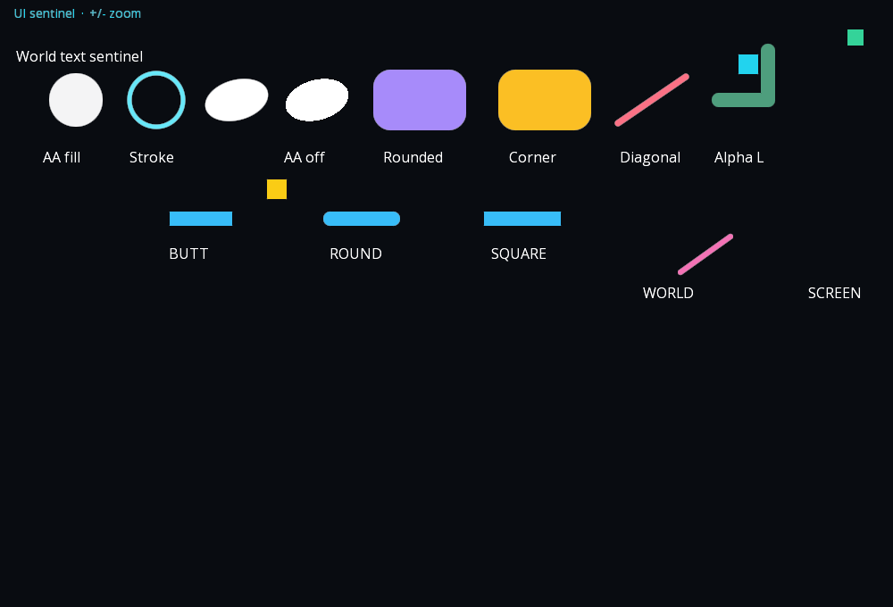
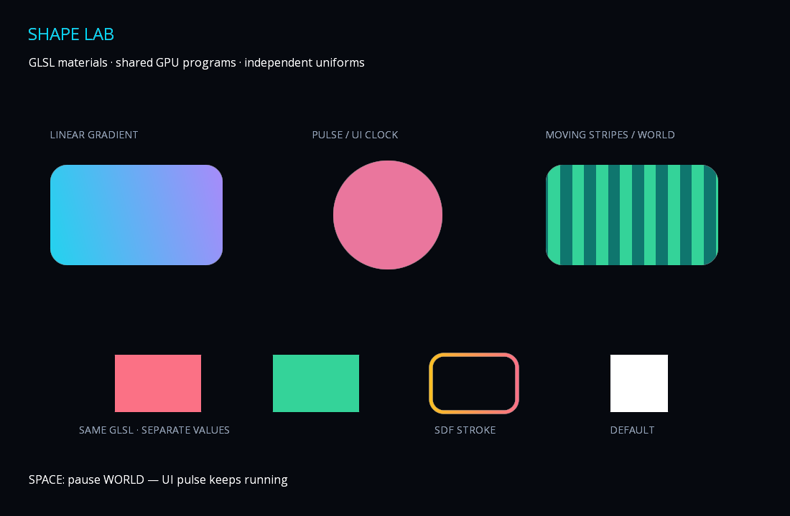

# Figury z antialiasingiem i materiały shaderowe

Nowy rdzeń ma renderer SDF dla koła, prostokąta z zaokrągleniami i polilinii. `ShapeRenderer2D.antiAlias` domyślnie włącza wygładzanie tych figur; można je wyłączyć. Szerokość obrysu i promień narożnika są w jednostkach lokalnych figury. Obrys jest wyśrodkowany na granicy, a promień narożnika ograniczony do połowy krótszego boku.

Polilinie mają końcówki `BUTT`, `ROUND`, `SQUARE` i łączenia `ROUND`. Jedna figura jest rysowana jako suma odległości w jednym przebiegu, więc przezroczystość nie kumuluje się na łączeniach. Limit to 64 punkty po usunięciu kolejnych duplikatów; przekroczenie zgłasza błąd. Polilinia z jednym efektywnym punktem daje koło dla ROUND, pusty wynik dla pozostałych końcówek.

`space = WORLD` używa kamery; `SCREEN` używa logicznych pikseli okna i jest rysowane po wszystkich figurach/sprite/tekstach świata. W każdej przestrzeni obowiązuje layer/order. Wygładzanie wykorzystuje pochodne GLSL i rozmiar fizycznego framebufferu: pas przejścia ma około jednego piksela również po obrocie, skalowaniu i zmianie zoomu. Osobny overlay Scene2D/UI pozostaje nad tym przebiegiem. Zdegenerowane transformacje są pomijane. Geometria przekraczająca bezpieczny zakres obliczeń float w shaderze (także zbyt małe odcinki lub granice zlewające się po zaokrągleniu) zgłasza błąd przed wysłaniem do GPU.

```java
var panel = ShapeRenderer2D.rectangle(180, 80);
panel.cornerRadius = 16;
panel.strokeWidth = 2;
panel.space = ShapeRenderer2D.Space.SCREEN;
var route = ShapeRenderer2D.polyline(List.of(
    new Vector2(0, 0), new Vector2(60, 0), new Vector2(60, 40)), 8);
route.lineCap = ShapeRenderer2D.LineCap.ROUND;
```

Style są zachowywane przez jawny codec SceneJson v1; wcześniejsze pliki bez nowych pól otrzymują domyślne wartości. Polygon nadal używa wcześniej triangulowanego wypełnienia bez AA; ustawienie jego antiAlias=true zgłasza brak obsługi. Nie ma obrysu polygon, bevel/miter joins, clippingu ani postprocessingu. Własne materiały kolorystyczne dla figur SDF opisano poniżej.

Demo: `./gradlew :javity-desktop:run --args='--shapes'`. Test rzeczywistego OpenGL: `./gradlew :javity-desktop:shapesSmoke`. Kontroluje piksele AA i wersji bez AA, alpha, cap/corner, SCREEN/WORLD, sprite/tekst/UI, zoom, ruch kamery i resize. Sprawdzone na Linux x64 z Mesa/Xvfb; inne platformy wymagają osobnej weryfikacji.



Dalszy etap: AA polygon, bevel/miter, render targets oraz postprocessing. Nie tworzyć shaderów ani meshów co klatkę. UI Rectangle nadal ma własny współdzielony shader rounded/border w UiTheme.

Inspiracja: [Shapes z Unity](https://acegikmo.com/shapes/). To własna implementacja na libGDX, bez zależności od Unity i bez kodu komercyjnej biblioteki.

## Materiały GLSL jako komponenty Shapes

`ShapeRenderer2D` jest komponentem GameObject. Jego opcjonalne pole `material` przyjmuje `ShapeMaterial2D`; null zachowuje dotychczasowy wygląd. Materiał zmienia kolor wewnątrz istniejącej maski SDF, zachowując AA, stroke, rounded i WORLD/SCREEN. Nie zastępuje geometrii ani vertex shadera.

```java
var panel = object.addComponent(ShapeRenderer2D.rectangle(240, 140));
panel.cornerRadius = 24;
panel.material = ShapeMaterial2D.gradient(Color.CYAN, Color.PURPLE, .25f);

var pulse = ShapeMaterial2D.pulse(Color.RED, Color.BLUE, .6f);
panel.material = pulse;
object.addComponent(new ShapeShaderAnimator(pulse, "u_time", 1, Clock.UI));
```

Importy materiałów: `org.javity.render`; Clock: `org.javity.effects.Clock`. Animator pożycza materiał, zwiększa wskazany FLOAT uniform o rate × delta i respektuje enabled, czas WORLD/UI oraz pauzę sceny. Nie podłącza sam materiału do figury. Materiał współdzielony przez kilka figur ma wspólne wartości — wystarczy jeden animator danego uniformu. Osobne instancje materiału mają niezależne wartości, nawet gdy używają tego samego programu GPU.

Presety:

- `gradient(start, end, angleRadians)`: liniowy gradient przez rzut lokalnych granic figury; uwzględnia środek off-center polilinii i promień koła. Uniformy: u_colorA/u_colorB (VEC4), u_angle (FLOAT).
- `pulse(base, pulse, rateHz)`: sinusoidalna zmiana koloru, rate w cyklach na sekundę; u_time/u_rate (FLOAT), u_colorA/u_colorB (VEC4). Animator aktualizuje u_time.
- `stripes(a, b, frequency, speed)`: pionowe pasy na lokalnym X; frequency w cyklach na lokalną jednostkę, speed w cyklach na sekundę. Uniformy: u_frequency/u_speed/u_time (FLOAT), u_colorA/u_colorB (VEC4).

### Własna funkcja koloru

```java
var material = ShapeMaterial2D.custom(
    "vec4 shapeColor(vec2 local, vec4 tint) { return u_color * tint; }",
    Map.of("u_color", ShapeMaterial2D.UniformType.VEC4))
    .setColor("u_color", Color.CORAL);
panel.material = material;
```

Funkcja ma kontekst GLSL1.20 i dokładną sygnaturę `vec4 shapeColor(vec2 local, vec4 tint)`. Można dołączyć własne funkcje pomocnicze. Nie dodawaj `#version`, `main` ani deklaracji uniformów do źródła; jawny schemat generuje deklaracje FLOAT/VEC2/VEC4. Wartości ustawiaj przez setFloat/setVector2/setColor, a odczytuj przez getFloat/getVector2/getColor. Schemat jest niemutowalny, wartości Color/Vector2 są kopiowane. Nieznane nazwy, zły typ i wartości niefinite są odrzucane. Uniformy zaczynają od zera, także alpha VEC4. Nazwy silnika, GLSL i przestrzeń gl_ są zastrzeżone. Nieużywany uniform może zostać usunięty przez kompilator i jest bezpiecznie pomijany przy uploadzie.

To zaufany kod aplikacji, nie sandbox dla obcych shaderów. Silnik mnoży wynik koloru przez teksturę i pokrycie SDF; alpha jest uwzględniana raz. Błędy kompilacji GLSL zgłaszają log sterownika przy pierwszym użyciu.

Materiał jest obiektem CPU i nie wymaga dispose. Przy pierwszym użyciu definicji renderer sprawdza kompilację i linkowanie na tymczasowych uchwytach, następnie tworzy docelowy program i zapisuje go w cache; wszystkie wartości instancji są przesyłane przed rysowaniem. Walidacja wstępna omija błąd libGDX w sprzątaniu nieudanego ShaderProgram i usuwa wszystkie własne tymczasowe uchwyty. Nie wykonuje się ponownie przy użyciu cache. Cache ma limit 32 różnych własnych definicji na renderer; przekroczenie zgłasza błąd, a wcześniej używane materiały nadal działają. Zamknięcie GdxRenderer/SmoothShapeRenderer zwalnia GPU, również gdy obiekty materiałów nadal istnieją. Nie twórz nowych definicji shadera co klatkę — zmieniaj uniformy.

Polygon z własnym materiałem jest jawnie odrzucany. Standardowy SceneJson nie posiada rejestru materiałów: zapis figury z materiałem zgłasza błąd zamiast cicho tracić efekt. Do utrwalania materiałów aplikacja musi dostarczyć własny jawny codec/rejestr; GLSL nie jest automatycznie odtwarzany z danych sceny.

Demo: `./gradlew :javity-desktop:run --args='--materials'`. Space zatrzymuje WORLD stripes, pozostawiając aktywny UI pulse. Test native: `./gradlew :javity-desktop:materialsSmoke`.


