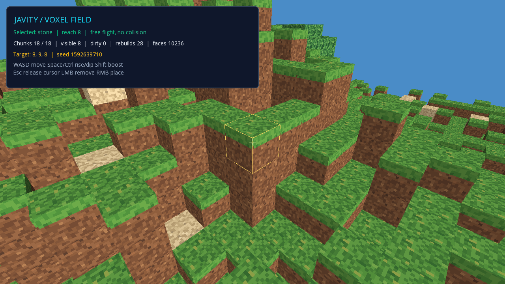
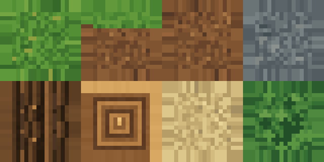

# Voxele i chunki

Status: wdrożone i zweryfikowane na Linux x64, JDK 25 i rzeczywistym OpenGL Mesa. Pozostałe platformy wymagają osobnego uruchomienia.

Opcjonalny moduł `javity-voxel` oddziela dane świata od GPU. Jeden chunk to 16×16×16 bloków; jeden renderowany chunk odpowiada jednemu obiektowi sceny. Air ma ID 0. Początkowo bloki są pełnymi nieprzezroczystymi sześcianami, z różnymi teksturami ścian.



```sh
./gradlew :javity-desktop:run --args='--voxels'
./gradlew :javity-desktop:voxelSmoke
```

WASD i mysz sterują postacią FPS; Space skacze, a Shift biegnie. F przełącza swobodny lot, używany przy edycji i debugowaniu; w tym trybie Space/Ctrl zmieniają wysokość, a Shift przyspiesza. Esc zwalnia kursor. LMB usuwa wskazany blok, RMB stawia wybrany na sąsiedniej ścianie. Pierwszy klik przechwytuje mysz. Klawisze 1–5 lub kółko wybierają materiał. Wskaźnik ma zasięg 8 jednostek; stawianie poza załadowanym światem jest odrzucane.

W trybie FPS stawianie jest odrzucane, gdy nowy blok nachodzi na ciało postaci. Powrót z lotu do miejsca wewnątrz bloku lub niezaładowanego obszaru ustawia postać na bezpiecznym spawnie.

Postać rozpoczyna nad terenem z miejscem na głowę. Kontroler demo zapewnia chodzenie, sprint, skok, grawitację i kolizję osiowo wyrównanego pudełka (AABB) z pełnymi blokami. Nie jest to ogólny silnik fizyki voxelowej: nie ma płynów, obrażeń, schodów ani obsługi bloków przezroczystych. Wolny lot omija kolizje i grawitację.

## Dane świata

Rejestr bloków konfiguruje się przed utworzeniem świata; później jest zamrożony. Świat ma jawny limit chunków. Chunk musi zostać załadowany przed edycją. Odczyt brakującego chunku oznacza powietrze, ale zapis nie generuje automatycznie nowego terenu.

Współrzędne świata są całkowite, Y oznacza wysokość, bok bloku ma jednostkę 1. Ujemne współrzędne używają floorDiv/floorMod: x=-1 to chunk -1, lokalne x=15. Pierwsza wersja ogranicza bloki do [-1048576,1048575] w każdej osi.

Mesher usuwa ściany pomiędzy sąsiadującymi blokami także przez granice chunków. Zmiany na brzegu unieważniają właściwych sąsiadów; ładowanie i usuwanie chunku także zmienia widoczność ich ścian. Kolejka przebudów jest deduplikowana i ograniczona liczbą załadowanych chunków.

## Przykład konfiguracji

```java
BlockRegistry blocks = new BlockRegistry();
int grass = blocks.register(new BlockDefinition("grass", 1, 1, 2, 0, 1, 1));
VoxelWorld world = new VoxelWorld(blocks, 64);
world.loadChunk(new ChunkPos(-1, 0, 0));
world.loadChunk(new ChunkPos(0, 0, 0));
world.setBlock(-1, 0, 0, grass);
world.setBlock(0, 0, 0, grass);

AtlasLayout layout = new AtlasLayout(80, 40, 16, 2, 4, 2);
// atlas to Texture dostarczona przez aplikację; camera to PerspectiveCamera.
VoxelChunkRenderer chunks = new VoxelChunkRenderer(game, world, atlas, layout);
```

Wspólna ściana tych dwóch bloków nie jest generowana. Usunięcie jednego bloku oznacza oba chunki jako dirty. `setBlock` zwraca, czy dane faktycznie się zmieniły; nie trzeba wcześniej odczytywać tej samej wartości.

```java
// game.start() wykonaj wcześniej, po utworzeniu sceny/kamery.
game.step(delta);
camera.update(); // przed cullingiem adaptera musi mieć aktualny frustum
chunks.update(camera, 2); // maksymalnie dwa chunki, poza ModelBatch
renderer.render(game);
```

`VoxelRaycaster.cast(world, origin, direction, 8, 64)` zwraca Optional trafienia z pozycją bloku, ścianą i komórką do stawiania. Gdy promień zaczyna wewnątrz bloku, dystans wynosi 0, a enteredFace/placementCell są null. Nie traktuj tego jako wskazanej ściany. Kierunek jest normalizowany bez zmiany wejściowych Vector3.

## Własność GPU i kolejność klatki

`VoxelChunkRenderer` pożycza atlas i posiada utworzone modele/meshe. Zamknij adapter przed teksturą i przed utratą kontekstu GL. Nie zamykaj atlasu przez materiał pojedynczego chunku. `ModelRenderer` nie jest właścicielem modelu.

Adapter aktualizuje się poza aktywnym `ModelBatch`. Wykonaj `Game.step`, następnie zaktualizuj kamerę/frustum i adapter, aby kamera sterowana komponentem nie miała opóźnienia klatki. Jeśli adapter utworzy renderer chunka pomiędzy krokami, `Game.initializePendingComponents()` synchronicznie wykona jego `onCreate` przed rysowaniem, bez aktualizacji zegarów WORLD/UI i bez kolejnego `Game.step`; wymiana istniejącego mesha zachowuje go do czasu przygotowania nowego renderera. Budżet oznacza liczbę chunków przebudowywanych w klatce, nie gwarancję czasu w milisekundach.

`VoxelWorld` ma jednego aktywnego konsumenta kolejki dirty. Nie podłączaj równocześnie dwóch adapterów do tej samej kolejki. Zamykanie i ponowne tworzenie adaptera nad zachowanymi danymi ma odbudować wszystkie załadowane chunki. Generacja chunku identyfikuje jego cykl load/unload, a nie liczbę edycji bloków. `rebuildCount(position)` dotyczy bieżącego załadowania; po unload jest zerowany. `totalRebuilds()` pozostaje sumą udanych przebudów danej instancji adaptera.

## Kolizje chunków Bullet (Task 5 C1)

Opcjonalny `javity-voxel-physics3d` mostkuje załadowany `VoxelWorld` do `Physics3D`; moduł CPU voxel nie zależy od Bullet. Dodaj najpierw `Physics3D`, a potem `VoxelCollisionAdapter` do tej samej gry:

```java
Physics3D physics = game.addSystem(new Physics3D(new Vector3(0, -9.81f, 0)));
VoxelCollisionAdapter collisions = game.addSystem(new VoxelCollisionAdapter(world, physics, 2));
```

Adapter sam rejestruje przygotowanie przed rzeczywistym krokiem fizyki. Nie korzysta z GPU renderera ani kolejki dirty renderera. `VoxelWorld` przechowuje dla załadowanych chunków osobną rewizję zawartości; `collisionSnapshot` kopiuje bloki wraz z generacją i rewizją. Zmiana wartości bloku podnosi rewizję, zapis tej samej wartości nie. Renderowanie i kolizje mogą więc konsumować zmiany niezależnie.

Geometria jest deterministycznym scaleniem zajętych komórek w pełne pudełka AABB; każdy niezerowy blok jest pełnym sześcianem. Adapter tworzy najwyżej jeden statyczny `StaticCompoundCollider3D` na chunk, w tym pusty opis bez natywnego ciała. Limit wynosi 4096 pudełek/prymitywów na ciało. Budżet pracy na renderową klatkę domyślnie wynosi jeden chunk; można go skonfigurować dodatnim limitem, który adapter ogranicza do `VoxelWorld.maxLoadedChunks()`. Catch-up do ośmiu ticków nie mnoży limitu prób publikacji. Nie ma obiektu na blok ani zależności od tekstur, kamery, meshera lub kontekstu GL.

`isChunkCollisionReady(position)` jest prawdziwe tylko dla aktualnej, załadowanej generacji i rewizji po zatwierdzeniu dokładnej konfiguracji natywnej. `isCollisionReadyVolume(minX, minY, minZ, maxX, maxY, maxZ)` sprawdza wszystkie chunki dotknięte zamkniętym AABB; brakujące, oczekujące lub nieaktualne chunki dają `false`. Przyszły kontroler kapsuły powinien sprawdzać cały omiatany obszar kapsuły dla ruchu, skoku i korekcji. To jest polityka gotowości dla kontrolera, nie fizyczna ściana graniczna: zwykłe dynamiczne ciało Bullet może uciec poza załadowany teren lub wpaść w nieznany obszar.

Zmiany kolizji publikuje `Physics3D` dopiero w pre-fixed-step hooku po aktualizacji WORLD, po ponownym sprawdzeniu generacji i rewizji. Zwykłe UI/query/`refresh()` nie może opublikować staged kandydata. Nieudany natywny kandydat zachowuje poprzednią geometrię, ale readiness pozostaje zamknięte aż do udanej próby aktualnej rewizji. Adapter zamyka swój hook przed usunięciem własnych obiektów; nie zamyka `VoxelWorld`, rendererów ani atlasu.

```sh
./gradlew :javity-voxel-physics3d:test
```

Testy desktopowe korzystają z natywnych bibliotek Bullet bez OpenGL. Nie walidują Androida. Kontroler kapsuły C2 i demo/debug draw C3 należą do opcjonalnych modułów opisanych w [docs/physics3d.md](physics3d.md); nie zmieniają AABB trybu `--voxels`. Pełna obsługa streamingu pozostaje poza tym zakresem.

## Oryginalne tekstury



Atlas runtime znajduje się w `javity-desktop/src/main/resources/org/javity/demo/voxels/atlas.png`. Ma 80×40 px, osiem tekstur 16×16 px i gutter 2 px, filtr nearest bez mipmap. `atlas.json` opisuje układ; obrazowe Y=0 odpowiada niskiemu V w libGDX. Góra ściany próbkuje v0, dół v1.

```sh
python3 tools/generate-voxel-atlas.py
```

Generator używa wyłącznie standardowej biblioteki Pythona i odtwarza atlas, metadane oraz powiększony podgląd. Tekstury są autorskie; warunki użycia znajdują się obok w LICENSE.txt.

## Zakres pierwszej wersji

Pełne przebudowy widocznych ścian, skończony świat zarządzany przez aplikację i kontroler FPS z blokową kolizją w demie. Swobodny lot służy edycji i debugowaniu. Streamowanie, greedy meshing, LOD, przezroczyste bloki, zapis świata, oświetlenie, ogólny system fizyki oraz multiplayer wymagają osobnych rozszerzeń.

## Wyniki weryfikacji — 2026-10-15

Czysty build całego projektu: **400 testów Java, zero błędów, failures i pominięć**. Z tego 24 testy dotyczą danych/meshingu/DDA, a 4 generatora terenu. Dodatkowe 11 testów sprawdza CPU controller FPS.

`voxelSmoke` sprawdza rzeczywiste texele PNG, głębię i ukryte ściany, budżet przebudów, culling, edycje na granicy, ponowne podłączenie adaptera, unload/reload tej samej pozycji i rollback po wyjątku. Siatka checkerboard ma 49152 wierzchołki i 73728 indeksów; próba pikseli obejmuje końcową ścianę z wpisów 73710+. Śledzone uchwyty GL potwierdzają zwolnienie buforów i zachowanie pożyczonego atlasu.

Test sceny: 38 klatek, 18 załadowanych chunków, 8 widocznych, 0 dirty, 29 udanych przebudów, 10236 ścian. Sprawdzane są też grounded spawn, ściany/sufit, skok/sprint, kierunek myszy, zakaz postawienia bloku w graczu i bezpieczny powrót z free-fly. Rzeczywisty widoczne okno pomocnicze GLFW wymusza utratę i odzyskanie fokusu; sprawdzane są callbacki, zwolnienie kursora i reset pierwszej delty myszy. Wersja konfiguracji bez poprawki daje oczekiwany błąd, aktualna przechodzi. Test resize wywołuje API aplikacji, nie udaje systemowego przeciągania krawędzi okna.

Gotowa dystrybucja działa z tym samym screenshotem poza repozytorium; ZIP zawiera moduł, atlas, metadane i licencję. Osobno przeszły dotychczasowe tryby modern/map/shapes/materials/legacy. [Raport](voxel-verification.json). Smoke zapisuje `artifacts/voxels/gallery.png` oraz `proof.json` po kontroli cleanup/GL0. Nie uruchamiano zdalnego GitHub Actions.

## Awatar FPS/TPP

Demo `--voxels` używa proceduralnego oryginalnego atlasu i przygotowanej siatki weighted body z
autorskimi regionami głowy, tułowia, rąk i nóg. Ubranie i narzędzie są sztywnymi częściami rig-u;
F5 przełącza układ kamery, C/T widoczność slotów, a E uruchamia maskowaną animację ręki. Kamera TPP
wykonuje ciągły sweep objętości near-plane po promieniu rozszerzonych bloków. Interakcje nadal
zaczynają raycast w oku gracza, niezależnie od pozycji kamery TPP.

Natywny smoke sprawdza F5 przy aktywnym ruchu i użyciu, pauzę WORLD, powtarzany keyDown oraz
rzeczywistą utratę/odzyskanie fokusu z wyczyszczeniem zatrzasku F5. Dowód numeryczny i zrzuty FPS,
TPP, wall clearance, czystego boomu oraz widoków observer są w
[`docs/artifacts/avatar`](artifacts/avatar/). Szczegóły architektury i granice zgodności opisuje
[`docs/avatars.md`](avatars.md).
